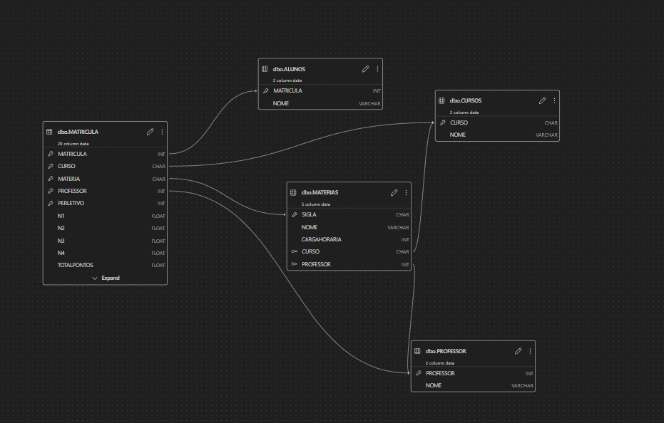

# Sistema de Gestão Acadêmica — UniversidadeVenturi

**Aluna:** Daniela Venturi  
**Instituição:** Universidade da Região de Joinville — UNIVILLE  
**Disciplina:** Banco de Dados II  
**Tecnologia:** Microsoft SQL Server (T-SQL)

## 1. Objetivo

Desenvolver um banco de dados acadêmico para gerenciar alunos, cursos, professores, matérias, matrículas, notas, faltas e resultados finais, utilizando recursos da linguagem SQL e procedures no SQL Server.

## 2. Funcionalidades

- Criação do banco de dados e das tabelas com chaves primárias e estrangeiras.
- Cadastro de alunos e matrícula automática em todas as matérias do curso escolhido.
- Cadastro de notas e faltas dos quatro bimestres.
- Cálculo da soma das notas, média e total de faltas.
- Validação das notas, faltas e dados da matrícula.
- Verificação do preenchimento das quatro notas antes do processamento final.
- Cálculo da frequência e classificação do resultado do semestre.
- Cadastro da nota de exame por meio de uma procedure específica.
- Recálculo da média final e do resultado após o exame.
- Consultas para acompanhar alunos, cursos, matérias, matrículas, notas e resultados.

## 3. Tecnologias utilizadas
- SQL
- Visual Studio Code com extensão para SQL Server

## 4. Arquivos do projeto

| Arquivo | Descrição |
|---|---|
| `01_criar_banco.sql` | Cria o banco, as tabelas, os relacionamentos e os dados iniciais. |
| `02_matricula_automatica.sql` | Cria a procedure de matrícula automática. |
| `03_cadastrar_notas.sql` | Cria a procedure de cadastro e processamento das notas. |
| `04_testes.sql` | Executa testes das procedures. |
| `05_consultas.sql` | Contém consultas para visualizar os dados. |
| `06_nota_exame.sql` | Cria a procedure para lançar a nota do exame e recalcular o resultado. |

**Modelagem do Banco de Dados**

## 5. Ordem de execução

Execute os arquivos nesta ordem, em uma instância do SQL Server:

1. `01_criar_banco.sql`
2. `02_matricula_automatica.sql`
3. `03_cadastrar_notas.sql`
4. `06_nota_exame.sql`
5. `04_testes.sql`
6. `05_consultas.sql`

**Atenção:** o primeiro arquivo foi preparado para a criação inicial do banco. Antes de executá-lo novamente, verifique se o banco já existe e contém dados.

## 6. Regras acadêmicas adotadas

A implementação atual utiliza os seguintes critérios provisórios:

- Média igual ou superior a 7: aprovado diretamente.
- Média igual ou superior a 4 e inferior a 7: exame.
- Média inferior a 4: reprovado.
- Frequência inferior a 75%: reprovado.
- Após o exame, média final igual ou superior a 5: aprovado, desde que a frequência seja suficiente.

Esses critérios devem ser ajustados caso a especificação do professor estabeleça regras diferentes. O cálculo da frequência também considera cada falta como uma hora de ausência.

## 7. Como testar

Execute `04_testes.sql` depois de criar o banco e as procedures. O arquivo cria um aluno de teste, cadastra notas nos quatro bimestres, verifica o resultado e, caso o aluno fique de exame, registra a nota utilizando a procedure específica.

O arquivo de testes cria um novo aluno a cada execução. Por isso, execute-o conscientemente para evitar registros duplicados.

## 8. Considerações finais

O projeto demonstra a utilização de tabelas relacionais, chaves primárias e estrangeiras, procedures, validações, operações de atualização e consultas SQL aplicadas a um sistema de gestão acadêmica.

---

**Daniela Venturi**  
Universidade da Região de Joinville — UNIVILLE  
Banco de Dados II
